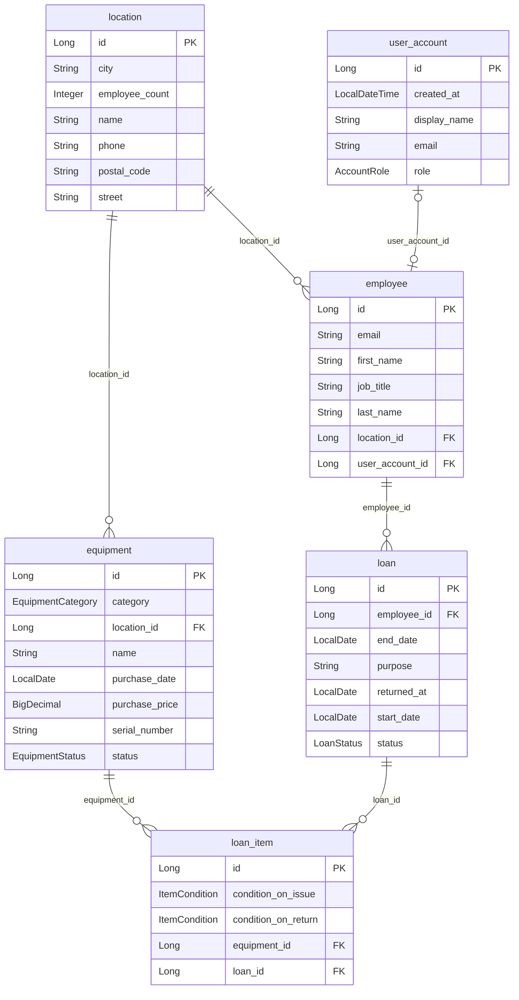

# Schemat bazy danych

Plik generują reguły projektu (panel Maven → Lifecycle → verify). Nie edytujcie go ręcznie.

Tabele: 6 · kolumny: 39 · relacje: 5 × @ManyToOne, 1 × @OneToMany, 1 × @OneToOne, 0 × @ManyToMany

| Tabela | Encja | Kolumny | Klucze obce |
|---|---|---|---|
| employee | Employee | 7 | location_id, user_account_id |
| equipment | Equipment | 8 | location_id |
| loan | Loan | 7 | employee_id |
| loan_item | LoanItem | 5 | equipment_id, loan_id |
| location | Location | 7 | — |
| user_account | UserAccount | 5 | — |

